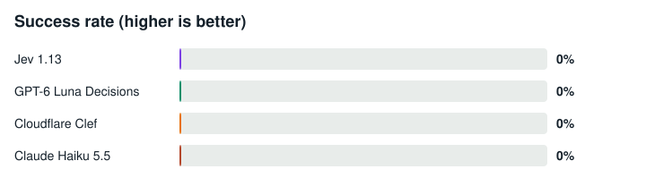
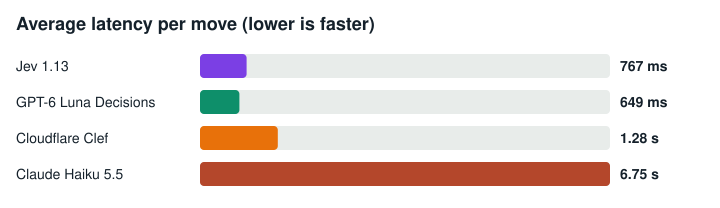
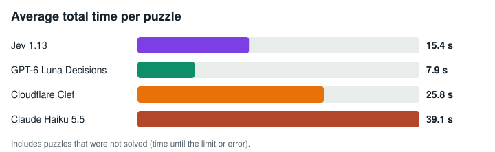
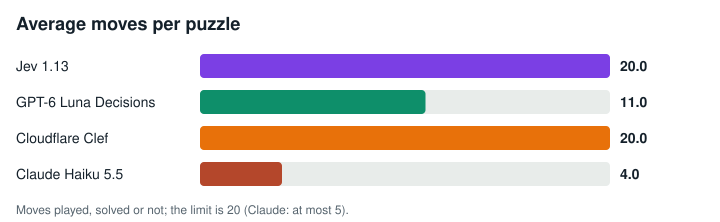
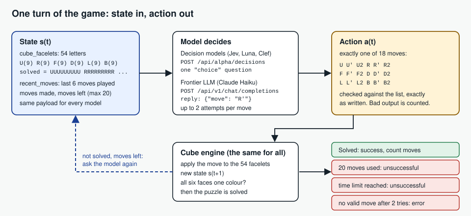
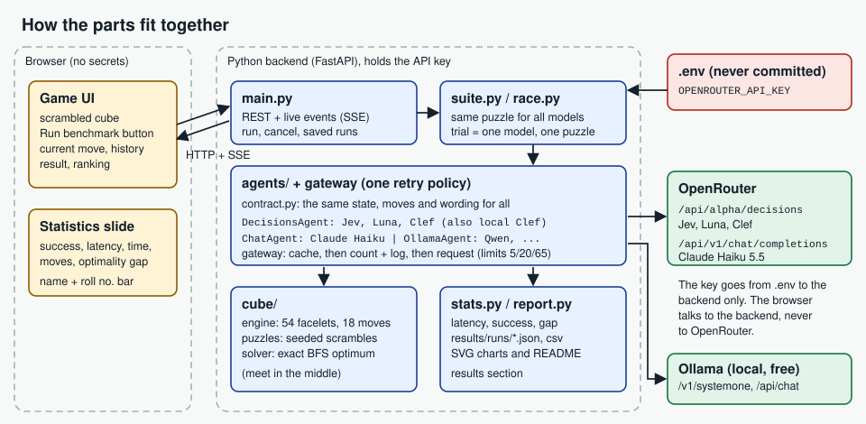

# Rubik's Cube Race: fast decision models vs a frontier LLM

**AI Engineering, Assignment 02**

| | |
|---|---|
| **Name** | Mir Ahmed |
| **Roll number** | 23i-0142 |
| **GitHub repository** | https://github.com/MirAhmedMalik/AI-Engineering-02.git |
| **Screen recording** | [`demo/demo.mp4`](demo/demo.mp4) |

> **Screen recording:** [Watch `demo/demo.mp4`](demo/demo.mp4). It shows the four models playing (time, moves, thinking status), the final ranking with the *Solved / Ran out of moves / Out of time* style labels, the final statistics slide, and my name and roll number on screen the whole time.

**Contents:** [1. Result at a glance](#1-result-at-a-glance) · [2. What I built](#2-what-i-built-and-where-to-find-it) · [3. The teacher's rules](#3-the-teachers-rules-and-where-the-code-enforces-them) · [4. Results step by step](#4-results-step-by-step) · [5. Answers to the five questions](#5-answers-to-the-five-questions) · [6. My trials and effort](#6-my-trials-and-effort-everything-i-ran) · [7. How to run it](#7-how-to-run-it) · [8. Design](#8-design-state-action-and-fairness) · [9. Security](#9-security) · [10. Project structure](#10-project-structure) · [11. Honest limits](#11-honest-limits)

---

## 1. Result at a glance

**Final real experiment** (OpenRouter, my own key, one cube exactly 3 moves from solved: scramble `R D' F`, shortest solution `F' D R'` = 3 moves, move limit 20):

| Rank | Model | Type | Final label | Moves | Stickers in place (start: 26 of 54) | Avg latency / move | Requests | Cost |
|---:|---|---|---|---:|---:|---:|---:|---:|
| 1st | Jev 1.13 | Decision model | Ran out of moves | 20 | 26 | 767 ms | 20 | $0.0009 |
| 2nd | Claude Haiku 5.5 | Frontier LLM | Request budget used up | 4 | 26 | 6.75 s | 5 | $0.0021 |
| 3rd | GPT-6 Luna Decisions | Decision model | Error (HTTP 502, refused by OpenAI) | 11 | 19 | 649 ms | 12 | $0.0007 |
| 4th | Cloudflare Clef | Decision model | Ran out of moves | 20 | 19 | 1.28 s | 20 | $0.0041 |

Total: **58 of 65 requests, $0.0079** (cap $0.30). Ranking rule of the app: solved models first (fewer moves, then less time); the others by stickers in place, then by time.

**What the experiment shows**

1. **No model solved the cube.** Success rate is 0% for all four, so the optimality gap cannot be computed.
2. **The decision models are about 5x to 10x faster per move** than the frontier LLM (Luna 649 ms and Jev 767 ms against Haiku 6.75 s). Luna is the fastest.
3. **Speed did not bring quality.** The start state has 26 of 54 stickers in place. Jev and Haiku ended at 26 (no progress), Luna and Clef ended at 19 (worse than the start).
4. **The models repeat moves instead of planning.** For example Jev alternated `U` and `U'`, and Clef repeated `D2`. Their confidence was low (Clef 0.02 on average). They choose one move at a time from a string of 54 letters and cannot plan ahead.
5. **The request limits worked as designed.** Claude stopped at exactly 5 requests, and every request was counted before it was sent.

---

## 2. What I built and where to find it

| Assignment requirement | What I did | Where |
|---|---|---|
| Game UI: scrambled cube, **Run benchmark** button, each model's current move, move history, final result | Browser app with 3D and unfolded cube, live move list per model, final ranking and result labels | `frontend/`, `app/main.py` |
| Deterministic cube engine, 54-facelet state | One engine for every model; 18 moves computed from 3D geometry; "solved" check | `app/cube/engine.py` |
| Statistics dashboard: average latency per move, total solve time, total moves, success rate, optimality gap | Dashboard and a final statistics slide; all values also saved as CSV | `frontend/`, `app/stats.py`, `results/runs/*/summary.csv` |
| Optimality gap by exact BFS | Meet-in-the-middle breadth-first search gives the true shortest solution | `app/cube/solver.py` |
| API key only in the backend `.env` | Key read only by the backend; `.env.example` provided; never sent to the browser, cache, log or results (tests check this) | `app/config.py`, `.env.example` |
| Decisions API for Jev, Luna, Clef; chat completions for the LLM | Two adapters, one retry/validation policy for all models | `app/agents/decisions.py`, `app/agents/chat.py` |
| Persistent cache checked before every request | Every valid answer is saved on disk and replayed for free | `app/gateway.py`, `app/store.py`, `data/<backend>/cache.jsonl` |
| Counters that are never reset | Request counters are saved to disk before each request and survive a restart | `app/store.py`, `data/<backend>/usage.json` |
| Live latency logged apart from cache time | Two separate fields: `latency_ms` and `cache_ms` | `app/stats.py`, `request_log.jsonl` |
| One real OpenRouter experiment, the rest on Ollama | Real run on OpenRouter; Clef, Qwen, DeepSeek, Gemma on Ollama | `app/agents/ollama.py` |
| Record solve status, moves, latency, gap, API calls, cache hits, cost | All of these are in the tables of this README and in the CSV files | `results/runs/*` |
| Screen recording in the repo, linked here | `demo/demo.mp4` | [`demo/demo.mp4`](demo/demo.mp4) |
| README with all statistics and the five answers | Sections 4 and 5 | this file |

Also included: more than 140 automated tests (engine, solver, adapters, retry policy, cache, limits, restart persistence, race, statistics, API, report), a practice mode with simulated models, a free model-ID checker, and a usage script.

---

## 3. The teacher's rules and where the code enforces them

| Rule | Value | Enforced in |
|---|---|---|
| Start state | A cube **exactly 3 moves** from solved (checked with the exact solver) | `app/cube/puzzles.py` (`teacher` test set) |
| Move limit | **20** moves, then "not solved" | `app/race.py` (`MOVE_LIMIT`) |
| Claude requests | **At most 5** real requests in the whole experiment, failed ones and retries included, so at most 5 moves | `app/store.py` (`MAX_CLAUDE_REQUESTS`) |
| Decision models | At most **20** real requests each | `app/store.py` |
| All models together | **65** real requests (the code can never be set above 95; the key dies at 100) | `app/store.py` |
| Money cap | `MAX_COST_USD=0.30`: a request is refused **before** it is sent if it could push the spending over the cap | `app/store.py` |
| No open loops | Every request is counted and saved before it is sent; at most 2 tries per move | `app/gateway.py` (`MAX_ATTEMPTS=2`) |
| Cache | Every valid answer is saved; the cache is checked before every request | `app/gateway.py` |
| No reset | Counters and cache are read from disk at start-up and never reset by a restart | `app/store.py` |
| Logging | A `request_start` line is written **before** each request; live latency and cache time are stored apart | `data/<backend>/request_log.jsonl` |
| Ollama | The other experiments run on local models: free, no limit | `app/agents/ollama.py` |
| Same input for all | Every model gets the same state, the same moves and the same wording | `app/agents/contract.py` |

---

## 4. Results step by step

### Step 1: Practice mode (no real requests)

Before any real request, I tested everything with simulated models: the race, the limits, the cache (a second run answers entirely from the cache with 0 new requests), the restart persistence and the cost cap. The automated tests prove the same rules (limits, cache, restart, cost cap, key never leaked). Practice runs are ignored by the report, so they can never appear in the results by accident.

### Step 2: Ollama experiment (local models, free)

Run `run-20261104-134639-ollama-teacher`: same cube (`R D' F`), models played one after another, request timeout 600 s, trial time limit 3600 s. These are local models on my laptop CPU, so the times are long.

| Model | Final label | Moves | Avg live latency / move | Total time | Calls / cache hits | What happened |
|---|---|---:|---:|---:|---|---|
| Qwen (`qwen3:4b`) | Ran out of moves | 20 | 48.6 s | 2 min 15 s | 7 / 13 | Played 20 moves, not solved. 13 moves were replayed from the cache of an earlier run. |
| Gemma (`gemma3:4b`) | Ran out of moves | 20 | 55.3 s | 4 min 49 s | 11 / 9 | Played 20 moves, not solved. 9 moves came from the cache. |
| DeepSeek (`deepseek-r1:1.5b`) | Error | 2 | 173.3 s | 20 min 1 s | 2 / 2 | No answer within 600 s on move 3, twice. |
| Clef (`clef-flash`) | Error | 0 | n/a | 3 min 5 s | 2 / 0 | Ollama's own server crashed on the first move (`llama-server`, exit status `0xc0000409`, a known Ollama problem). |

All four: **0% solved**. Ollama requests are free, so the cost is $0.

### Step 3: The real OpenRouter experiment (final)

Run `run-20261104-153636-openrouter-teacher` (2026-11-04), seed 42, 1 puzzle × 4 models, move limit 20 (Claude 5), trial time limit 300 s, request timeout 90 s, up to 2 attempts per move, models raced at the same time. Question wording `PROMPT_STYLE=compact` (the same for every model; chosen with `scripts/probe_luna.py`, see section 6).

**Speed**

| Model | Avg latency / move | Median | p95 | Avg total time / puzzle |
|---|---:|---:|---:|---:|
| Jev 1.13 | 767 ms | 651 ms | 913 ms | 15.4 s |
| GPT-6 Luna Decisions | **649 ms** | 495 ms | 1.24 s | **7.9 s** |
| Cloudflare Clef | 1.28 s | 1.21 s | 2.23 s | 25.8 s |
| Claude Haiku 5.5 | 6.75 s | 7.00 s | 7.12 s | 39.1 s |

**Quality**

| Model | Success rate | Solved | Total moves | Optimality gap | Optimal solves |
|---|---:|---:|---:|---|---:|
| Jev 1.13 | 0.0% | 0 / 1 | 20 | n/a (no solved puzzle) | 0 / 1 |
| GPT-6 Luna Decisions | 0.0% | 0 / 1 | 11 | n/a (no solved puzzle) | 0 / 1 |
| Cloudflare Clef | 0.0% | 0 / 1 | 20 | n/a (no solved puzzle) | 0 / 1 |
| Claude Haiku 5.5 | 0.0% | 0 / 1 | 4 | n/a (no solved puzzle) | 0 / 1 |

**Reliability and cost**

| Model | Moves played | Invalid outputs | Timeouts | HTTP errors | Retries | Avg confidence | Final status |
|---|---:|---:|---:|---:|---:|---:|---|
| Jev 1.13 | 20 | 0 | 0 | 0 | 0 | 0.281 | Ran out of moves |
| GPT-6 Luna Decisions | 11 | 0 | 0 | 2 | 1 | 0.261 | Error |
| Cloudflare Clef | 20 | 0 | 0 | 0 | 0 | 0.021 | Ran out of moves |
| Claude Haiku 5.5 | 4 | 0 | 0 | 1 | 1 | n/a | Request budget used up |

**API calls, cache and cost**

| Model | Actual API calls | Cache hits | Failed requests | Live latency / move | Cache response time | Actual cost (USD) |
|---|---:|---:|---:|---:|---:|---:|
| Jev 1.13 | 20 | 0 | 0 | 767 ms | n/a | 0.000926 |
| GPT-6 Luna Decisions | 12 | 1 | 2 | 582 ms | 1.487 ms | 0.000731 |
| Cloudflare Clef | 20 | 0 | 0 | 1.28 s | n/a | 0.004108 |
| Claude Haiku 5.5 | 5 | 0 | 1 | 6.75 s | n/a | 0.002104 |

Total counted for this backend (saved on disk): **58 of 65** requests; cache entries 55; total cost **$0.0079** of the $0.30 cap. Luna shows 12 calls in the race and 13 on disk: the 13th was the one-request wording test (`probe_luna.py`), whose answer was reused from the cache as Luna's first move (that is the 1 cache hit).

**Failed attempts in the final run (every one was counted as a request)**

| Model | Move | Attempt | Kind | Detail |
|---|---:|---:|---|---|
| GPT-6 Luna Decisions | 12 | 1 | http_error | HTTP 502: OpenAI refused to answer question "next_move" |
| GPT-6 Luna Decisions | 12 | 2 | http_error | HTTP 502: OpenAI refused to answer question "next_move" |
| Claude Haiku 5.5 | 1 | 1 | http_error | HTTP 429: OpenRouter could not verify available credits for this request in time. Retry shortly. |

Haiku's failed first request still counts as one of its 5 requests, so Haiku could play only 4 moves.

**Charts**









Charts for the Ollama run: [success rate](results/charts/ollama_teacher_success_rate.svg), [latency](results/charts/ollama_teacher_latency.svg), [solve time](results/charts/ollama_teacher_solve_time.svg), [moves](results/charts/ollama_teacher_moves.svg).

Raw data: `results/runs/run-20261104-153636-openrouter-teacher/` and `results/runs/run-20261104-134639-ollama-teacher/` (`run.json`, `trials.csv`, `moves.csv`, `summary.csv`). The request counters, cache and log are in `data/openrouter/`.

---

## 5. Answers to the five questions

All answers are for the final real experiment (Step 3). The Ollama run is added where it helps.

**1. Which model is fastest at making decisions?**
**GPT-6 Luna Decisions**, with 649 ms per move on average. Ranking: Luna 649 ms, Jev 767 ms, Clef 1.28 s, Claude Haiku 5.5 6.75 s. The LLM needs about **10.4 times** as long per move as Luna. On my laptop the local Ollama models are much slower (Qwen 48.6 s per move) because they run on a CPU.

**2. Which model has the highest solve rate?**
**None.** All four models solved 0 of 1 puzzles (0%), on OpenRouter and on Ollama. With one cube and a 3-move scramble, this is a small experiment, so it is a first look, not a final ranking.

**3. Which model found the shortest solutions, and how close to the optimum?**
**No model found a solution**, so the optimality gap (model moves minus the exact shortest, 3 moves) cannot be computed. The closest model by stickers in place were Jev and Haiku with 26 of 54, which is exactly the number at the start, so they made no net progress.

**4. Did the fastest model also give the best solution quality?**
**Cannot say.** Luna was the fastest, but no model solved the puzzle, so quality cannot be compared by solutions. By stickers in place, Luna (19) ended worse than the start (26), and Jev and Haiku (26) did not improve it.

**5. Fastest decision model, frontier LLM or hybrid agent?**
The numbers give **no winner on quality**, because nobody solved the cube. On speed the decision models are clearly better (about 10x per move), and they cost less in this run ($0.0007 to $0.0041 each, against $0.0021 for Haiku's 5 requests; a decision model plays up to 20 moves, the LLM only 4). My reading (an opinion, not proven by this experiment): a **hybrid agent** is the sensible design. A fast decision model proposes moves, and a verifier checks progress (for example sticker count or an exact solver) and sends hard cases, such as repeated moves or low confidence, to the LLM. To choose with confidence, a larger test is needed: more puzzles and repeats, which the 65-request limit did not allow.

---

## 6. My trials and effort (everything I ran)

I ran the real experiment several times before the final result. Each failure had a different cause, and I fixed each one in the code. Everything is kept in [`docs/RUN_HISTORY.md`](docs/RUN_HISTORY.md).

### 6.1 All runs, in order

| # | When | Where | What I ran | What happened | Requests | Cost |
|---|---|---|---|---|---:|---:|
| 1 | first try | OpenRouter (teacher's key) | First real test | `HTTP 401: API key expired`. The app stopped after 1 counted request. | 1 | $0 |
| 2 | 2026-11-03 | OpenRouter (my own key, v4) | Clef-only test, then a full run | Clef used its 20 requests (2 of them were failed 401 tries with the old key). Jev stopped at move 17: Windows blocked saving the counter file (`WinError 5`). Luna was refused (HTTP 502). Haiku was cut off at a 300-token limit. No model solved the cube. | 56 | $0.0069 |
| 3 | 2026-11-04 14:58 | OpenRouter (v6) | Full run | Jev and Clef played 20 moves, not solved. Luna refused again (HTTP 502, 0 moves). Haiku was cut off at a 1000-token limit (0 moves). | 44 | $0.0070 |
| 4 | 2026-11-04 15:36 | OpenRouter (v8, **final**) | Wording test, then the full run | All four models played moves (see Step 3). No model solved the cube. | 58 | $0.0079 |
| 5 | 2026-11-04 (earlier) | Ollama (v5) | First local test | Models "thought" for minutes and played no move: the laptop CPU was too slow for all models together. | – | $0 |
| 6 | 2026-11-04 13:20 | Ollama (v6) | Qwen, DeepSeek, Gemma raced at the same time | All three hit the 900 s limit (Qwen 13 moves, Gemma 9, DeepSeek 2). | 51 (all Ollama runs) | $0 |
| 7 | 2026-11-04 13:46 | Ollama (v6) | Four models one after another, longer limits | Qwen and Gemma 20 moves each; DeepSeek timed out; Clef crashed in Ollama (see Step 2). | | $0 |

**Total OpenRouter real runs:** 1 + 56 + 44 + 58 = 159 requests, about **$0.022** in total, far below my $0.30 cap. The final experiment used its own fresh counters (58 of 65).

### 6.2 Problems I found and fixed

| Problem found in a run | Cause | What I changed |
|---|---|---|
| `HTTP 401: API key expired` | The teacher's key had expired | Used my own OpenRouter key, kept only in `.env` |
| An old key overrode the new one | A key was still set in the terminal environment | Cleared it; the app reads `.env` only when no variable is set |
| Jev stopped at move 17 (`WinError 5`) | Windows briefly locked `usage.json` while saving the counters | The counter save now retries up to 10 times before giving up |
| Haiku cut off (`finish_reason=length`), twice | Answer limit too small (300, then 1000 tokens) | Limit raised to 4000, and a cut-off answer now retries with a doubled limit instead of repeating the same request |
| Luna refused (`HTTP 502`, "OpenAI refused to answer") | OpenAI's side; the cause is not documented | Wrote `scripts/probe_luna.py`: it sends at most 2 real requests with different wording (same cube information). The `compact` wording worked, so `PROMPT_STYLE=compact` is used for **every** model, which keeps the race fair |
| Ollama models very slow, or all timing out | Three or four models competing for one laptop CPU | Added `--sequential` and longer time limits (`OLLAMA_REQUEST_TIMEOUT_S`, `OLLAMA_TRIAL_TIME_LIMIT_S`) |
| Clef crashed on Ollama (`0xc0000409`) | A known Ollama problem with `clef-flash` | Kept the result and reported it honestly; Clef is still measured on OpenRouter |
| The report script crashed (`IndexError`) | No decision model had a latency (Clef on Ollama made no move) | Fixed `app/report.py` and added a test |
| Wrong Ollama adapter for Clef | Clef is a decision model served on `/v1/systemone`, not a chat model | Routed it through the decision adapter without authentication |

### 6.3 Engineering work behind the results

- Built the cube engine, the exact solver, the three backends (simulated, Ollama, OpenRouter), the gateway with cache, counters, limits and money cap, the browser UI, the statistics and the report generator.
- Wrote more than 140 automated tests and checked the rules end to end against fake OpenRouter and Ollama servers.
- Moved from Claude Opus 5.5 to **Claude Haiku 5.5** to stay under my own spending limit.
- Went through 8 versions of the code (v1 to v8), fixing every problem that showed up in a real run.

---

## 7. How to run it

Needs Python 3.10 or newer. On Windows PowerShell:

```powershell
git clone https://github.com/MirAhmedMalik/AI-Engineering-02.git
cd AI-Engineering-02
cd AI-Engineering-02
python -m venv .venv
Set-ExecutionPolicy -Scope Process -ExecutionPolicy RemoteSigned
.venv\Scripts\activate
pip install -r requirements.txt

copy .env.example .env
# edit .env: OPENROUTER_API_KEY, STUDENT_NAME, STUDENT_ROLL_NO, MAX_COST_USD=0.30
```

The app has three modes (first drop-down in the page, or `--backend` in the terminal):

| Mode | Models | Cost | Use |
|---|---|---|---|
| **Practice** (default) | simulated | nothing | test the app and the limits. Not real results |
| **Ollama** | Clef, Qwen, DeepSeek, Gemma on your computer | nothing | local experiments |
| **OpenRouter** | Jev, Luna, Clef, Claude Haiku | real, limited (65 requests) | the one real experiment |

```powershell
# 1. Practice (no cost)
python -m uvicorn app.main:app --port 8000     # open http://127.0.0.1:8000

# 2. Ollama (free). Run the models one after another:
python scripts/check_models.py --backend ollama
python scripts/benchmark.py --backend ollama --models ol_qwen ol_deepseek ol_gemma ol_clef --sequential

# 3. The real OpenRouter experiment
python scripts/check_models.py --backend openrouter     # free check, no request to a model
python scripts/probe_luna.py                            # optional: at most 2 real requests, tests the wording
python -m uvicorn app.main:app --port 8000              # choose OpenRouter (REAL), press Run benchmark once

# 4. Counters and report
python scripts/usage.py
python scripts/report.py --run-ids <openrouter run id> <ollama run id>
```

Run the tests: `pip install -r requirements-dev.txt` and `pytest`.

---

## 8. Design: state, action and fairness

The game is a state/action space. In every turn the model receives a **state** and picks one **action**; the engine applies it and the loop repeats until the cube is solved or a limit is reached.



- **State:** `cube_facelets` (54 letters in the order `U R F D L B`) and `recent_moves` (with `PROMPT_STYLE=compact`). The standard wording also sends the six faces, `moves_made` and `moves_remaining`.
- **Action space:** 18 moves: `U U' U2 R R' R2 F F' F2 D D' D2 L L' L2 B B' B2`. A half turn is one move.
- **Shared hint:** every model gets the same short hint: the cube starts only a few moves from solved, and do not play a move and then its inverse.
- **Terminal states:** solved, 20 moves used, time limit, request budget used up, no valid move after 2 attempts (error).
- **Fairness:** all models start from the same scrambled state (seeded), get the same instructions and the same retry policy (up to 2 attempts per move). Every retry, timeout and invalid output is logged and counted. An invalid answer is never repaired or turned into a move.
- **Latency:** live API latency of the request that produced each accepted move. Cached answers are timed separately.
- **Optimality gap:** model moves minus the exact shortest moves (0 = optimal), for solved puzzles only.

Details: [docs/DESIGN.md](docs/DESIGN.md).



| Test set | Scramble | Used for |
|---|---|---|
| Teacher setup | exactly 3 moves from solved (exact) | the real OpenRouter experiment and the Ollama run above |
| Warm-up | 3 to 4 random turns | Ollama: check adapters and engine |
| Primary | 4 to 5 random turns | Ollama: compare models |
| Extension | 15 to 20 random turns | Ollama: harder states |

---

## 9. Security

- The OpenRouter key lives only in the backend environment (`.env`, read by `app/config.py`). It is never put in frontend code, never returned by an API endpoint and never written to the cache, the counters, the log or the result files (tests check all of these).
- `.env` is in `.gitignore`; only the template `.env.example` is committed.
- A real run needs a confirmation, so it cannot start by accident.
- Hard limits: 20 / 5 / 65 requests, a money cap of $0.30, and the counters are saved before each request.

---

## 10. Project structure

```
app/
  cube/engine.py        54-facelet state, 18 moves, solved check
  cube/solver.py        exact shortest solution (BFS, meet in the middle)
  cube/puzzles.py       seeded scrambles: teacher (exactly 3), warm-up, primary, extension
  gateway.py, store.py  cache, request counters, limits, money cap and request log (saved in data/)
  agents/contract.py    the shared state / moves / wording sent to every model
  agents/decisions.py   Decisions API adapter (Jev, Luna, Clef; local Clef on /v1/systemone)
  agents/chat.py        chat completions adapter (Claude Haiku)
  agents/ollama.py      Ollama chat adapter (Qwen, DeepSeek, Gemma)
  agents/base.py        one retry / validation policy for all models
  agents/mock.py        simulated models (practice mode only)
  race.py, suite.py     one trial, one race, a full benchmark run
  stats.py, report.py   statistics, charts, results tables
  main.py               FastAPI backend (REST + live events)
frontend/               index.html, app.js, cube.js, style.css
scripts/                benchmark.py, report.py, check_models.py, probe_luna.py, usage.py, record_demo.py
tests/                  automated tests
data/                   request counters, cache and request log (do not delete)
results/                runs/<run id>/ (run.json, trials.csv, moves.csv, summary.csv), charts/*.svg
demo/                   the screen recording
docs/                   DESIGN.md, RECORDING.md, RUN_HISTORY.md, diagrams
```

---

## 11. Honest limits

- **One cube, one run per model.** The request limits (20 / 5 / 65) allow only one cube on OpenRouter, so these numbers are a first look, not a full comparison. The Ollama setup could take more puzzles, but the models were too slow on my laptop.
- **Claude Haiku had only 4 moves.** Its 5-request limit allows at most 5 moves, and one request was lost to an OpenRouter credit-check error (HTTP 429), so Haiku could not be judged fairly on solving.
- **Luna was refused by OpenAI** at move 12 (HTTP 502). The cause is not documented. I reduced the problem with a different question wording, but did not remove it.
- **Ollama results are from a slow laptop CPU.** Clef (`clef-flash`) crashed inside Ollama, and DeepSeek 1.5B timed out. The Ollama run used the `standard` wording; the final OpenRouter run used `compact`.
- **Several real attempts came before the final one.** They are listed in section 6, with their causes and costs. The final experiment ran from fresh counters on my own paid key, with the same limits: Claude 5, each decision model 20, total 65.
- **The Decisions API is an alpha endpoint.** Model IDs and names can change; `scripts/check_models.py` verifies them, and the response parser is strict and sits in one function (`parse_decisions_response`).
